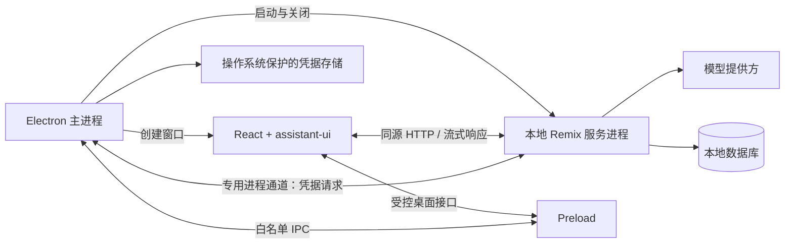

# 架构规范

状态：目标架构；当前已完成 UI、模拟流式链路与基本 Electron 宿主，数据库和真实模型仍为规划。更新日期：2026-10-08。

## 当前实现与目标的差异

按用户最新优先级，先实现可替换内核的 UI：`ChatWorkspace` 通过参数接收 `ConversationEngine` 与 `HostAdapter`，不导入 Electron 或供应商 SDK。浏览器和桌面宿主均只实现复制；HTTP 对话适配调用 Remix `/api/chat`，服务端使用预设内容模拟流式回复。

当前使用 assistant-ui 管理页面内会话，不另建消息 store。没有数据库、凭据、用户文件或远程模型调用。流协议暂只有 `text-delta`、`finish`、`error`；runId、去重、版本号、持久化及恢复将在真实内核接入时扩展。请求校验和同源 Origin 校验已实现，Electron 入口已实现桌面 Cookie/Host 鉴权；纯 Web 预览不包含该桌面中间件。

下文描述最终目标，不能据此认定数据库、模型凭据管理、自动恢复与全部生产加固已经完成。详见 [决策 0001](decisions/0001-ui-and-adapters.md)。

## 1. 范围与选型

首版提供单用户桌面聊天、本地历史记录、模型连接设置、流式回答和停止生成。优先验证 Windows，代码结构保留 macOS/Linux 适配空间；其他平台在实际验证前不宣称支持。

固定技术栈为 Electron + Remix v2 + React + assistant-ui + TypeScript。Remix 承担真正的服务端职责，不作为只输出静态页面的路由库使用。具体 Electron、React、assistant-ui、Node.js 和构建工具版本在脚手架阶段按 peer dependencies 与打包结果确定，提交锁文件记录。

不在首版引入云端账号同步、多用户权限、插件市场、MCP、自动执行工具或多智能体编排。

## 2. 进程与职责

| 层                   | 负责                                                   | 不负责                             |
| -------------------- | ------------------------------------------------------ | ---------------------------------- |
| 主进程               | 窗口、应用生命周期、服务进程监管、凭据保护、系统对话框 | 模型调用编排、页面数据查询         |
| Preload              | 暴露经过命名、校验的最小桌面 API                       | 通用 `ipcRenderer`、直接凭据读取   |
| 本地服务进程         | 承载 Remix、数据库访问、模型适配、流式生成、运行状态   | 桌面窗口操作                       |
| Remix 路由           | loader 查询、action 变更、resource route 流式接口      | 在路由文件堆积完整业务实现         |
| React + assistant-ui | 界面、输入、消息展示、交互状态                         | 直接访问文件、数据库、模型密钥     |
| 公共契约             | 数据结构、事件与运行时校验规则                         | 服务端实现、Electron API、秘密数据 |

生产环境由 Electron 监管独立服务进程，优先验证 `utilityProcess` 承载打包后的 Node 服务入口。不能依赖用户电脑额外安装 Node.js，也不能将 Remix HTTP 服务直接挂在 Electron 主进程事件循环中。启动方式及原生数据库模块的兼容性必须在脚手架阶段验证。

## 3. 生命周期与访问路径

1. Electron 完成初始化并建立单实例约束，确定 `app.getPath('userData')` 下的数据路径。
2. 主进程为本次启动创建随机凭证，通过专用进程通道交给本地服务。
3. 服务仅监听 `127.0.0.1`，由系统分配可用端口；完成存储准备后向主进程报告就绪。
4. 主进程通过受控的 Electron session 为该服务地址设置会话凭证，再加载应用 URL。凭证不得出现在查询参数、页面数据、日志或持久化 Web Storage 中。
5. 服务鉴权中间件先于页面、静态资源与 API 路由执行。会话 Cookie 使用 HttpOnly、SameSite=Strict，并限制生命周期；回环 HTTP 不依赖 Secure Cookie 提供保护。变更请求另行校验精确 Origin，所有请求校验 Host，禁止开放 CORS。
6. 退出时取消生成、关闭数据库和服务进程。服务崩溃时显示可恢复错误；不要留下无监管进程或将旧请求自动重复提交给模型。

端口不是身份认证。就绪消息需要校验，启动应有超时和清理路径。服务重启应更换凭证并重新建立窗口会话。生产只加载打包产物，不使用 Vite 开发服务器；开发与生产入口分开配置。

## 4. 聊天数据流

1. 用户在 assistant-ui 中提交消息，客户端适配器调用同源 Remix 聊天 resource route。
2. 服务验证会话、模型配置、消息结构和输入大小，为请求建立唯一 `runId`。
3. 服务保存用户输入与待生成记录，从持久化历史组装模型上下文，调用 Provider Adapter。
4. Provider Adapter 将供应商输出转换为应用内部事件，Remix 用流式响应返回。
5. 客户端适配器把内部事件转换成 assistant-ui runtime 数据，React 更新界面。
6. 完成、失败或取消时保存终态与已有内容。停止操作通过 `AbortSignal` 传播至服务与上游模型请求，并释放资源。

首版拟采用 assistant-ui `LocalRuntime` 配合自定义 `ChatModelAdapter`，不强制增加 AI SDK 或云服务依赖。历史加载、线程切换与持久化通过适配层实现；UI runtime 不是数据库。具体适配 API 在安装锁定版本后验证。

流式传输采用 `fetch` POST + SSE 格式响应，避免使用只适合 GET 的原生 EventSource 发起聊天。应用自行定义并版本化事件契约，至少包含 `start`、`text-delta`、`finish`、`error`；携带 `runId`、`messageId` 和递增序号。客户端须处理跨网络块拆分、UTF-8 解码、异常断流和未知事件。

同一会话首版只允许一个活动生成。服务依据客户端请求标识防止重复提交；切换会话不能将输出写入另一会话。客户端中断连接视为取消；应用重启后将遗留的生成记录标记为中断，不自动重新计费生成。

## 5. 数据与凭据

拟采用 SQLite 保存会话、消息、生成记录和非敏感设置；数据库驱动与迁移工具在脚手架阶段验证后确定。文件位于 userData 的应用子目录，不能写入安装目录或仓库。

核心实体如下，属于应用领域模型，不直接复用供应商响应或 UI runtime 内部结构：

| 实体           | 最小字段                                                                                        |
| -------------- | ----------------------------------------------------------------------------------------------- |
| Conversation   | id、title、createdAt、updatedAt                                                                 |
| Message        | id、conversationId、role、contentParts、status、createdAt                                       |
| Run            | id、conversationId、assistantMessageId、clientRequestId、providerId、modelId、status、errorCode |
| ProviderConfig | id、displayName、baseUrl、modelId、credentialRef                                                |

生成状态至少区分 pending、streaming、completed、cancelled、failed、interrupted。时间统一保存 UTC；展示使用用户时区。schema 变更必须有版本化迁移，启动失败不能清空数据库恢复。

凭据由主进程经操作系统保护机制存储，服务仅通过专用进程通道按需获取并在内存使用。渲染层设置表单允许接收用户主动输入的密钥，但保存后立即清理，不提供回读明文 API。禁止将密钥放入 `VITE_*`、loader 返回值、打包代码或日志。系统保护不可用时必须明确失败或采用用户知情的临时会话模式，不能静默落盘明文。

本地优先不等于全盘加密：首版聊天数据库不承诺静态加密。默认日志只记录请求标识、耗时、状态和脱敏错误，不记录聊天正文、授权头或完整供应商响应。

## 6. Electron 与内容安全

- 显式设置 `nodeIntegration: false`、`contextIsolation: true`、`sandbox: true`。
- IPC 按操作建立白名单，校验调用窗口、主 frame、来源与参数；不接受任意频道、文件路径或命令。
- 限制导航与新窗口，外部链接仅允许明确的协议，经受控主进程接口打开。
- 为生产页面设置 CSP；不加载远程可执行脚本。开发所需放宽仅存在于开发配置。
- 将模型输出视为不可信内容；Markdown 默认禁用原始 HTML，链接需校验协议，代码块只展示不执行。
- Provider base URL 仅由用户设置并校验，不能由模型输出修改。远程连接使用 HTTPS；明确配置的本机模型可使用回环 HTTP。
- 对请求体、输出、并发和超时设限；原始错误留在脱敏日志中，界面使用可理解的错误信息。

## 7. 待实现阶段验证的事项

- Remix v2、React 和 assistant-ui 的精确兼容版本组合。
- `utilityProcess` 内服务启动、打包资源定位和退出清理。
- Cookie、Host、Origin 校验在开发和生产端口下的行为。
- SQLite 驱动的 Electron ABI 与安装包兼容性，以及凭据保护后端。
- SSR/hydration 与 assistant-ui 浏览器依赖隔离。

以上是实现检查点，不影响当前文档基线；若需要改变固定技术栈，应记录原因与用户决策。

## 参考

- [Remix v2 官方文档](https://v2.remix.run/docs/)
- [Electron 安全指南](https://www.electronjs.org/docs/latest/tutorial/security)
- [Electron Utility Processes](https://www.electronjs.org/docs/latest/tutorial/utility-process)
- [assistant-ui Custom Runtime](https://www.assistant-ui.com/docs/runtimes/custom/overview)
- [assistant-ui LocalRuntime](https://www.assistant-ui.com/docs/runtimes/custom/local-runtime)
